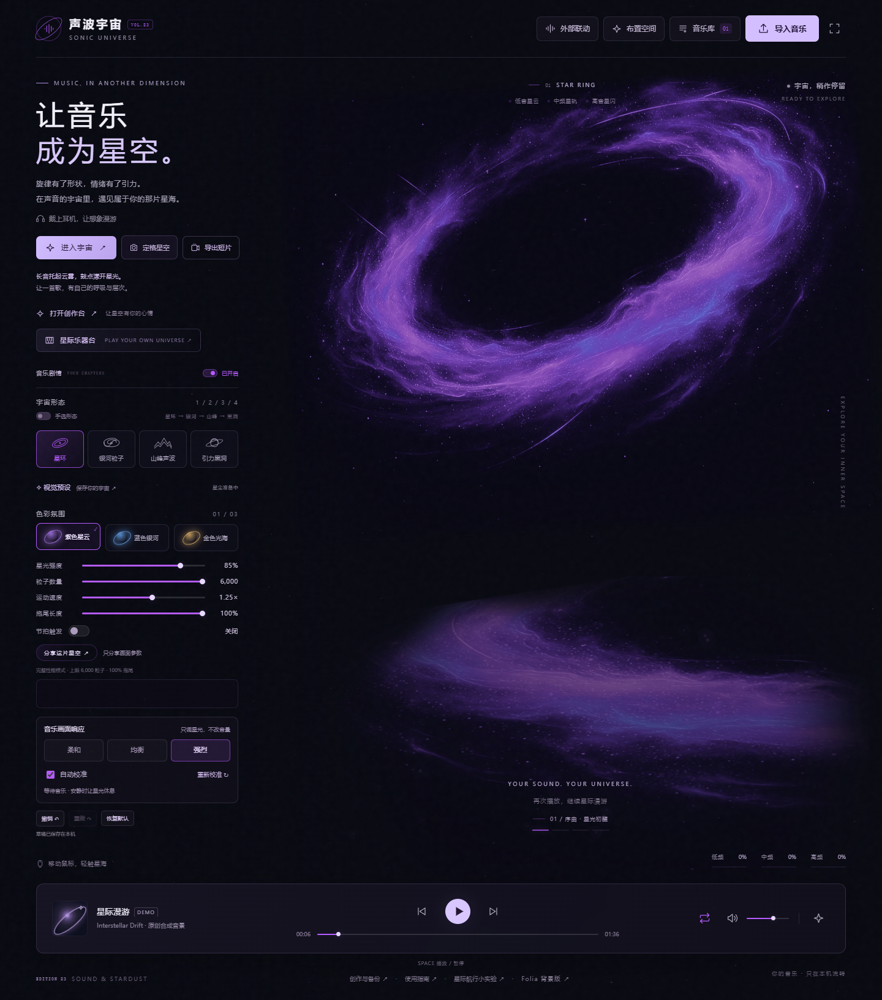
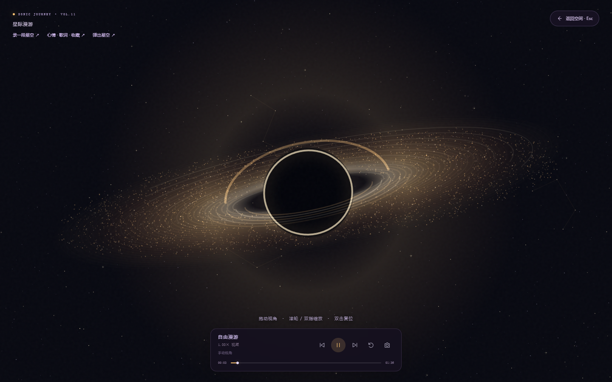

# 声波宇宙 · Sonic Universe

让音乐成为星空。一个在浏览器里运行的音乐视觉作品：低音推开星云，中频留下星轨，高音点亮星闪。在星环、银河、山峰与引力黑洞之间，看见一首歌的起伏。

**[进入在线体验](https://hgb-2005.github.io/sonic-universe/?v=32)** · **[完整使用说明](outputs/使用说明.md)** · **[有声黑洞示例](https://hgb-2005.github.io/sonic-universe/blackhole-demo.webm)**

## 第三十二版 · 稳定播放与时间点创作

- **画面有兜底**：启动超时、画布不可用或运行异常时显示轻量星光封面与跳动音频条，可播放示例并重试完整效果。
- **连接有结果**：Companion 检测最长 6.5 秒；离线时说明原因、禁用依赖在线服务的按钮，并提供重新连接。扫码有取消、超时和过期提示。
- **设备少吃力**：实际粒子数按设备上限创建；省电模式限制星尘、拖尾、分辨率并使用约 30 帧预览。后台暂停绘制；短片保持独立的导出质量。
- **一键套模板**：新增深空电影、金色柔光、省电星尘，连同原有八套预设共十一套，应用后可撤销、重做。
- **创作自动保存**：本机保存状态可见，失败可重试；关闭或切到后台前保存歌词、时间点与草稿。
- **拖动时间点**：点击轨道添加、拖动调整，方向键微调 0.1 秒（Shift 为 1 秒），支持文字、星爆、删除、撤销、重做，最多 60 个时间点。

## 第三十一版 · 会呼吸的歌曲封面与滚动歌词

这一版把正在播放的歌曲做成更有层次的界面。播放器封面扩大，增加唱片环、封面高光和随专辑图变化的模糊氛围光；歌曲标题下会显示歌手、专辑、来源和列表位置。没有封面或图片加载失败时，会回到当前主题的星云光晕，不影响播放。

歌词界面改成连续滚动舞台：当前句停在画面中央并放大发光，上一句和下一句向两侧渐隐；播放、暂停、自然切歌和拖动进度都会重新定位歌词，底部显示当前句数与总句数。歌词头部同步显示歌名、歌手和专辑，加载中、无歌词与解析失败都有对应提示。桌面、窄屏、低动态模式继续适配，本地音乐、汽水连接、星空、创作台、预设与短片导出功能保持不变。

## 第三十版 · 连接修复与旧版兼容

本机双击 **启动音乐入口.cmd** 后，可以在不下载歌曲文件的前提下搜索汽水音乐、扫码登录、读取收藏与个人歌单、显示歌词，并让能够公开播放的歌曲进入声波宇宙的播放队列。在线歌曲和本地歌曲都会驱动星环、银河、山巅与黑洞；上一首、下一首、暂停、进度和自然结束使用同一套播放逻辑。

- **完整在线入口**：本机 Companion 负责登录、搜索、收藏、歌单、歌词和临时音频代理；页面本身仍是同一个声波宇宙。
- **登录资料留在本机**：登录会话用当前电脑的本地密钥加密；Cookie、凭据和签名播放地址不会写入浏览器的音乐库、备份文件或 GitHub。
- **公开页面仍可独立使用**：`https://hgb-2005.github.io/sonic-universe/` 没有本机 Companion 时，四种星空、本地音乐、创作、明信片和短片照常工作；在线音乐区域会明确显示离线原因。
- **遵守平台边界**：作品不复制歌曲、不破解受保护音频，也不绕过会员、版权或 DRM。能内嵌播放的前提是服务能取得浏览器可用的普通音频；受保护歌曲会给出友好提示，并保留在汽水音乐中打开的入口。
- **可靠降级**：Companion 未安装、Node 版本不足或服务启动失败时，启动器会退回基础星空模式，不会留下黑屏。

## 第二十八版 · 汽水音乐歌单入口

这一版把作品从“只能播放本地文件”扩展成一条更轻量的音乐入口：在音乐库的「↗ 汽水音乐」中加入自己常听的歌，保存歌名、歌手、专辑或备注以及汽水音乐分享链接；点击歌曲会在新标签页打开汽水音乐。

- **单首与批量整理**：既可逐首填写，也可一次粘贴最多 100 行。支持 `歌名 | 歌手 | 专辑 | 链接`、全角竖线和制表符；每行必须带 `http://` 或 `https://` 分享链接。
- **自己的歌单**：汽水歌曲可以搜索、收藏、加入自定义歌单、排序、编辑和删除；刷新后仍保存在当前浏览器。
- **安全入口**：只接受不含账号密码的 HTTP(S) 地址，拒绝 `javascript:`、应用私链、畸形链接和重复链接。点击外链时以新标签页打开，并隔离页面来源。
- **声音驱动星空**：想用汽水音乐真正播放的声音改变星云时，在「外部联动」中选择「整个屏幕」并共享系统音频。选歌、切歌、暂停和音量仍在汽水音乐里操作。
- **本地与入口隔离**：汽水歌曲不会进入本地播放队列、随机播放、自动切歌或短片音频分析，也不要求音频文件。它们属于链接型音乐入口；内置音景与手动导入的本地歌曲仍按原流程播放。
- **隐私与备份**：页面只保存用户主动填写的元数据和分享链接，不下载、不复制音频，不读取汽水账号、会员状态、封面、歌词或播放进度。`.sonicpack` 备份会包含这些入口，但不会包含汽水音频。

本机地址与 GitHub Pages 属于不同网站来源，因此两边歌库分别保存。批量检查会先显示可加入、重复、无效和超过单次上限的数量，确认后才写入；已有链接和同一批中的重复链接都会被跳过。

## 第二十七版 · 从一首歌生成星空短片

现在可以不先选形态、不手动编排，直接选择一首本地歌曲。浏览器会在本机分析音乐能量，自动避开开头和结尾，推荐较完整的高潮片段，并把片段排成四章：

- **01 序曲 · 星光初醒**：星环随音乐缓慢展开。
- **02 漫游 · 旋律成河**：银河旋臂接住流动的旋律。
- **03 盛放 · 星河共鸣**：山巅声波抬高最明亮的部分。
- **04 余晖 · 光尘归寂**：引力黑洞收拢最后的余韵。

默认导出 720 × 1280 竖屏、30 秒短片，录制时音乐与画面同步进入文件。推荐起点可以手动修改，15 / 30 秒会重新计算四章时间线；录完可在页面预览并下载。音频分析、歌曲文件和短片都在本机处理，不会上传到服务器。



## 第二十四版 · 主题同色

这一版解决切换金色光海后，左上角标题高亮与主要控件仍保留紫色的问题。界面强调色现在跟随当前主题：金色光海使用暖金，蓝色银河使用冰蓝，紫色星云使用淡紫；标题高亮、操作按钮、形态选中态、响应按钮、滑块、播放键和提示条会一起平滑换色。

三张色彩缩略图继续分别展示紫色、蓝色与金色，保留直观的主题预览。星云结构、粒子、音频响应、预设、分享、定格与短片流程均未改变。本版在桌面与 390 × 844 移动视口检查三主题、四形态、控件颜色、页面横向溢出和转场过程。

## 第二十三版 · 星云回流

这一版处理首页下半屏的大片空白：主画面略微下移并纵向延展，下方增加一层由同一星云材质裁切、重组的缓慢回流。回流保留暗尘裂缝、不均匀密度和断续亮脊，边缘向左右柔和消散，并加入少量星点与鼠标微动，让首屏到播放器之间形成连续的星云电流。

四套形态各自保留原有主体结构，紫色、蓝色和金色主题仍共用同一套材质，只改变颜色。静默时回流结构完整，播放后只增强亮度、呼吸和局部星芒；控制面板与播放器文字保持清晰。本版曾在桌面顶部、滚动区域和 390 × 844 移动视口检查四形态、三主题、衔接边缘、横向溢出与加载错误。

## 第二十二版 · 暗尘裂缝体积星云

这一版按你选定的参考图重做四套主画面：星环、银河、山巅与引力黑洞都加入了细节丰富的体积星云层，保留原有音乐响应、控制面板、预设、定格与短片流程。低频推动星云呼吸，中频改变流动与旋转，高频留下星点闪光；叠加的软粒子继续让画面随声音变化。

- **星环**：紫蓝光带沿椭圆环体流动，中央保留深色留白，内外层次和柔光更接近参考画面。
- **银河**：多层旋臂、亮核与散星一起构成更密集的螺旋星云，静默时仍缓慢流动。
- **山巅声波**：层叠星云托起发光山脊，前后景深和雾化轮廓比网格波形更自然。
- **引力黑洞**：缩小的椭圆视界被流体吸积盘包围，核心保持不透明，边缘星芒与内圈热度更清晰。
- **主题与设备**：紫色、蓝色和金色主题沿用同一套细节层；移动端会降低叠加粒子与纹理绘制开销。

第二十二版在桌面与 390 × 844 移动视口检查四形态、三套主题、静默结构、音乐响应、分享链接、暂停恢复、短片录制和页面错误兜底，并确认四张体积星云纹理全部加载成功。

## 第十九版 · 让四种形态一起流动

星环、银河、山峰与引力黑洞现在共用一套流体星云语言：软圆光斑、分层辉光、持续噪声扰动和渐变衰减拖尾。没有音乐输入时，画面仍会缓慢呼吸；播放后用低频推动星云与黑洞光晕，中频改变旋转和山峦起伏，高频触发细碎星闪。

- **星环与银河**：环体与旋臂会自然弯曲、疏密变化，粒子沿切线留下光轨；银河粒子持续向中心缓慢旋入。
- **山巅声波与黑洞**：频谱化作多层半透明雾状山脊；黑洞拥有不透明深黑视界、流体吸积盘、内外层差速和星尘吞噬循环。
- **新的画面控制**：新增 0–100%「拖尾长度」和可选「节拍触发」，柔和／均衡／强烈三档映射统一适配四种形态。节拍触发默认关闭，开启后只在真实强鼓点出现时增加星爆与光晕脉冲。
- **统一转场与静默流动**：切换形态时，新旧星云约在半秒到一秒内交叠淡入淡出；暂停或静音后保留较慢的环境流动。
- **设备分级与容错**：桌面、平衡与移动端会分别限制粒子数量和拖尾强度；WebGL／Canvas、音频上下文异常时会显示说明与重启入口，不再只剩黑屏。
- **分享与预设**：八套内置预设都记录拖尾、响应和节拍设置。分享链接编码形态、色彩、拖尾、强度、粒子数、响应和速度，不包含歌曲、歌词或个人信息。

本版使用真实浏览器自动化检查四种形态和连续转场、黑洞不透明视界、0% 与 100% 拖尾差异、节拍开关、主页面／创作台／沉浸面板同步、分享恢复、刷新持久化、桌面与 390px 移动端性能分级及剪贴板拒绝后的只读链接回退。

## 第十八版 · 八种即用星空氛围

把内置星空预设扩展到 8 套，覆盖紫雾星环、冰蓝声脊、琥珀潮汐、紫晶旋臂等组合；沉浸漫游也可直接切换这些氛围。每一套都能继续细调，保存为自己的预设，并导入导出分享。

## 第十七版 · 留下自己的星空作品

页脚「创作与备份」把选歌、选星空、写歌词与收藏片刻、制作明信片串成四步。每一步可以直接打开对应工具，示例音乐也能参与创作。

点击「导出完整备份」下载 `.sonicpack` 文件，包含本地音频、封面、背景、歌词、歌单、收藏、演奏与草稿，最多 1 GB。在另一个网址或浏览器打开作品，选择「从文件恢复」后先查看内容摘要，再确认替换。取消或结构检查失败时保持原有内容；数据库恢复失败时回滚本次写入。已导出的视频和图片需另行保管，恢复前请关闭其他声波宇宙页面。

本机 Edge 已实际验证音频与歌词恢复、取消、截断文件拒绝及数据库事务失败回滚，并检查 390 像素手机视口；实体手机仍待验证。

## 第十六版 · 听见星云的呼吸

这一版细化声音的持续与起落：持续的低、中频缓缓托起雾层，重复的低频起音带出局部波纹，高频的持续与瞬间变化分别留下微光与星闪。变化只调整画面；声音分析不识别曲风、情绪、音符或乐器。

星空增加远处薄雾、中层云带与近处轻纱，保留云间暗隙，随手动视角产生不同程度的位移。纹理预先缓存，每帧复用；GPU 与 Canvas、乐器预览、明信片和有声短片共用同一组雾层。色彩过渡放缓，连续换景可从当前混合状态接续，鼓点表现保留局部扩散并收起整体抖动。

## 在星空里听见此刻

沉浸时，点右上角「选星空」，可以在深空电影、金色柔光、省电星尘等十一套氛围之间切换，也可以直接选择四种宇宙形态。画面缓缓相融，音乐保持当前进度。面板内能选择柔和、均衡、强烈的光响应，并调整拖尾与节拍触发；这些设置与主面板、创作台共用并保存在当前浏览器中。

轻触星空唤醒控制栏，明确拖动才接管视角，手机支持双指缩放。面板打开或键盘正在操作按钮时保持控制栏可见；关闭按钮和 Esc 可收起选景面板。浏览器也可能使用 Esc 退出原生全屏，此时返回主空间。

内置原创音景优先加载预先生成的 96 秒 MP3，减少刷新后的合成等待；资源无法读取或解码时自动回到原有合成，准备期间会显示提示。导入自己的音乐仍直接在本机播放。

低音继续控制星云的扩张与呼吸，200 Hz–4 kHz 的中频频谱留下短暂星轨，高音的变化唤起局部细碎星闪。轻声、停顿和暂停后自然收静；星轨记录近期频谱，不进行音符或音高识别。

主页面围绕播放、沉浸、定格和导出展开。原有星际航行收在页脚「星际航行小实验」中，作为可选入口。

新增图层共享主画布、乐器预览与短片输出，也支持 Canvas 兼容模式和系统减少动态效果。短片优先使用 VP8 编码，改善连续切换横竖画幅的录制启动。

## 从一首歌开始

1. 打开在线体验，点击播放，先听内置原创音景；也可以上传自己的 MP3、WAV 等浏览器支持的音频。
2. 打开「视觉预设」，试试「紫雾星环」「日冕引力」或「紫晶旋臂」，再调节拖尾长度；数字键 1 / 2 / 3 / 4 可切换四种形态。
3. 点击「进入宇宙」沉浸漫游，通过「选星空」边听边选景。轻触唤醒按钮，拖动旋转、滚轮或双指缩放，右上角返回空间。
4. 保存自己的视觉预设、定格星空明信片，或录制带声音的横屏／竖屏短片。

## 可以在这里创作什么

- **音乐星空**：Web Audio 分析声音，以 Canvas 流体粒子绘制四种星云，并保留 GPU／Canvas 兼容路径；支持连续转场、响应校准、拖尾、节拍触发、空间纵深与光晕。
- **自己的音乐空间**：音乐库、歌单、封面和背景；歌词编辑、歌曲草稿、收藏、A/B 排练与时间点编排。
- **汽水音乐入口**：在本机 Companion 模式下搜索、扫码登录、收藏、读取歌单与歌词；可公开播放的歌曲直接驱动星空，受保护歌曲仍可在汽水音乐中打开。
- **视觉收藏**：八种内置预设，自定义预设保存、JSON 导入／导出，以及创作撤销与重做。
- **星际乐器台**：鼠标、触屏或键盘弹奏旋律与鼓点，录制循环并叠加最多六层。
- **带声音的作品输出**：星空明信片、横屏和竖屏视频；WebGL 图层、歌词与乐器画面共用输出链路。
- **外部声音联动**：在支持的桌面浏览器中，经用户选择和授权，分析带音频的共享来源。



## 本地运行

Windows 用户安装 Node.js 24 或更高版本后，双击 **启动音乐入口.cmd** 即可运行完整在线入口。首次启动如果缺少 `companion` 依赖，会在本机安装；启动器只监听 `127.0.0.1:8765`，随后打开 `http://127.0.0.1:8765/?v=32`。**打开声波宇宙.cmd** 使用同一套逻辑。Node 不可用时，启动器会尝试用 Python 3 打开不带在线音乐的基础版本。

macOS、Linux 或希望手动运行完整入口时，在仓库根目录执行：

```sh
cd companion
npm ci
npm start
```

随后打开 `http://127.0.0.1:8765/`。Companion 同时提供网页和本机音乐接口，仅接受来自这个本机地址的请求。建议通过 HTTP 或 HTTPS 使用作品，以便浏览器完整提供音频和存储能力。

## 浏览器与数据

推荐使用桌面版 Edge 或 Chrome。手机支持触屏界面；共享声音、录制编码、全屏及可解码格式取决于浏览器和设备。共享声音需要在浏览器弹窗中选择带音轨的来源并启用音频共享，不能保证所有系统播放器都可捕获。视频采用实时录制，建议让页面保持在前台。

导入的音乐、图片、歌词、草稿和在线歌曲元数据保存在当前浏览器中，应用不会把这些内容上传到 GitHub。完整的汽水音乐在线功能只在本机 Companion 运行时可用；登录 Cookie、账号凭据和临时播放地址只留在 Companion 内存或加密的本地会话文件中。`127.0.0.1` 与 GitHub Pages 属于不同网站来源，两边歌库和草稿不会自动互通；不同浏览器也各自保存。可通过 `.sonicpack` 完整备份迁移，视觉预设也可单独导出 JSON。备份仅包含在线歌曲的公开元数据，不包含登录凭据、Cookie 或签名播放地址。

## 源码与部署

`outputs/index.html` 包含界面、Web Audio、Canvas 流体渲染与兼容绘制；`outputs/visual-system.js` 负责软粒子、噪声、拖尾、性能分级和分享参数，`outputs/visual-presets.js` 提供十一套内置预设，`outputs/music-motion.js` 处理三层声音包络与近期频谱，`outputs/online-music.js` 规范在线歌曲、歌词与 Companion 请求，`outputs/soda-library.js` 校验旧版汽水分享链接。`companion/` 包含仅监听本机的 Node 服务、汽水音乐适配器和加密会话存储。`outputs/interstellar-drift.mp3` 由内置合成算法预先生成，作品继续保留同一算法作为加载失败时的回退。

航行模式由 `flight.html`、`flight.css`、`flight.js` 和 `flight-core.js` 组成，不加载外部依赖。关卡与计分核心独立于帧率，使用 Web Audio 时钟对齐音乐与事件。它与原音乐星空共享网站地址，各自保存音乐资料和航行成绩。

安装 Node.js 24 后在 `companion/` 执行 `npm ci`，再回到仓库根目录运行 `node --test tests/*.test.cjs`。测试覆盖音乐短片、视觉参数、在线歌曲与歌词、Companion 接口、凭据隔离、作品备份、可选航行和既有视听逻辑。GitHub Pages 部署前还会安装 Companion 依赖、检查全部运行脚本语法并执行同一套测试。

GitHub Actions 将 `outputs/` 发布到 GitHub Pages；推送到 `main` 的作品更新会自动部署。仓库不包含本机音乐库、调试日志、历史截图或测试音轨。

第十四版在本机 Edge 中用真实 70 / 700 / 6000 Hz 音轨检查三层分工，以及静音文件、暂停收静、Canvas、沉浸和减少动态效果。回归检查覆盖预设导入导出、WebGL 像素与上下文恢复、乐器共用绘制、实际有声横竖屏短片和 320–1440 像素视口。手机布局采用桌面浏览器模拟，尚未在实体手机上验证。

第十五版增加沉浸选景、连续播放、响应同步、选择保存、键盘焦点、控制栏显隐、触屏轻触／拖动／双指缩放与 320–1440 像素布局检查，并检查减少动态效果和兼容绘制。实际生成 PNG 明信片与 1280 × 720 有声短片，解码核对音轨；横屏小窗口里，选景面板与播放栏分开显示。另检查预先生成音景的加载，以及文件缺失、解码失败与请求超时后的合成回退。手机触控使用桌面浏览器模拟，尚未在实体手机上验证。

第十六版用真实持续低音、重复低频起音、中频长音、高频短音和静音 WAV 检查不同包络与暂停收静；检查 GPU 像素、上下文恢复、连续打断的转场、Canvas、减少动态效果、乐器共用雾层，以及实际 PNG 和横竖屏有声视频。与第十五版在本机 Edge 的 1440 × 1000 和 390 × 844 视口做短时绘制耗时对照，结果接近；该结果不代表实体手机、长时发热或所有设备的表现。

第二十三版在桌面的 1440 × 1000、1920 × 1080 和移动端 390 × 844 视口检查四张体积星云纹理、四形态转场、三套主题、下方星云回流、拖尾边界、分享恢复、刷新持久化、实际短片录制和页面错误兜底。回流使用不规则蒙版、暗尘切缝与柔化侧边，在四种形态中维持同一视觉语言。手机部分使用浏览器触屏模拟，尚未替代实体手机的长时发热与帧率测试。

第二十二版在桌面的 1440 × 1000 和移动端 390 × 844 视口检查四张体积星云纹理、四形态转场、三套主题、拖尾边界、分享恢复、刷新持久化、实际短片录制和页面错误兜底。四种形态使用暗尘裂缝、疏密变化与断续亮脊的主体星云，粒子仅作稀疏点缀；三套色彩共用同一套材质结构。手机部分使用浏览器触屏模拟，尚未替代实体手机的长时发热与帧率测试。

第十一版已在本机 Edge 验证 GPU 与 Canvas 回退、四种形态切换、预设导入导出、数据迁移、实际有声短片录制、320–1440 像素布局及减少动态效果。发布检查另外覆盖项目子路径、连接提示和公网 HTTPS 页面。

## 可选：星际航行小实验

[打开星际航行](https://hgb-2005.github.io/sonic-universe/flight.html?v=13)，也可从音乐星空页脚进入。它有 15 秒安全练习和两种 60 秒航行，使用固定原创关卡与音景。电脑按方向键或 A／D，手机支持滑动或点击航道；空格暂停。返回音乐作品时恢复原歌曲与暂停位置。

航行暂不支持自选歌曲生成关卡，详细操作保留在使用说明附录中。第十三版已自动化检查练习、两种难度、暂停恢复、手动音乐对齐、旧纪录及原歌曲恢复。

## 参考与致谢

以下项目提供了视觉或工程思路：

| 项目 | 参考方向 |
| --- | --- |
| [Interactive Particles Music Visualizer](https://github.com/tgcnzn/Interactive-Particles-Music-Visualizer) | GPU 粒子与形态变换 |
| [Universe Music Visualizer](https://github.com/rrrl2617/universe-music-visualizer) | 黑洞吸积盘与宇宙氛围 |
| [phase-viz](https://github.com/7g3n/phase-viz) | 可序列化、版本化的视觉预设 |
| [Butterchurn](https://github.com/jberg/butterchurn) | 平顺、可中断的预设过渡 |
| [Astrofox](https://github.com/astrofox-io/astrofox) | 音频视觉与视频创作流程 |
| [vibez.surf](https://github.com/donth77/vibez.surf) | 音乐航道、左右移动与目标收集的玩法方向 |
| [Moon Rider](https://github.com/supermedium/moonrider) | 星空航路和沉浸音乐旅程的氛围 |

本作品按上述思路独立实现，没有打包这些项目的源码或运行时。仓库中的示例画面和黑洞视频使用内置原创音景生成。

航行模式的代码、固定关卡、音景与 Canvas 飞船／场景均在本仓库独立实现；参考项目没有作为依赖引入。

## 权利说明

本仓库公开展示作品与源码，暂未授予开源许可证。复用或再分发前请联系作者取得许可。用户自行导入的音乐与图片，其权利属于相应权利人。
