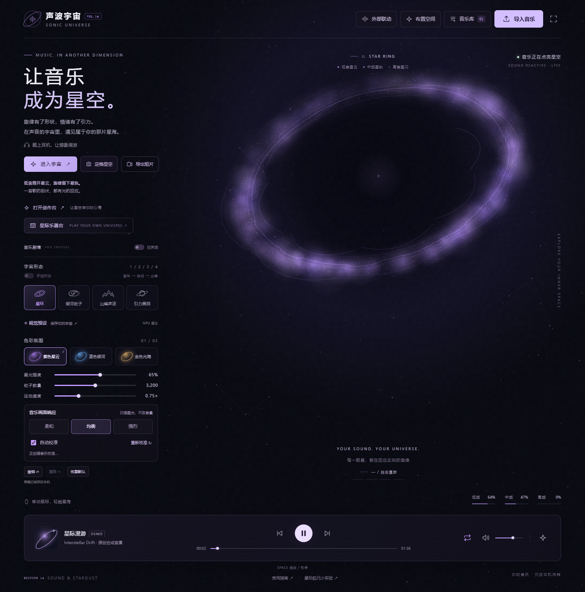
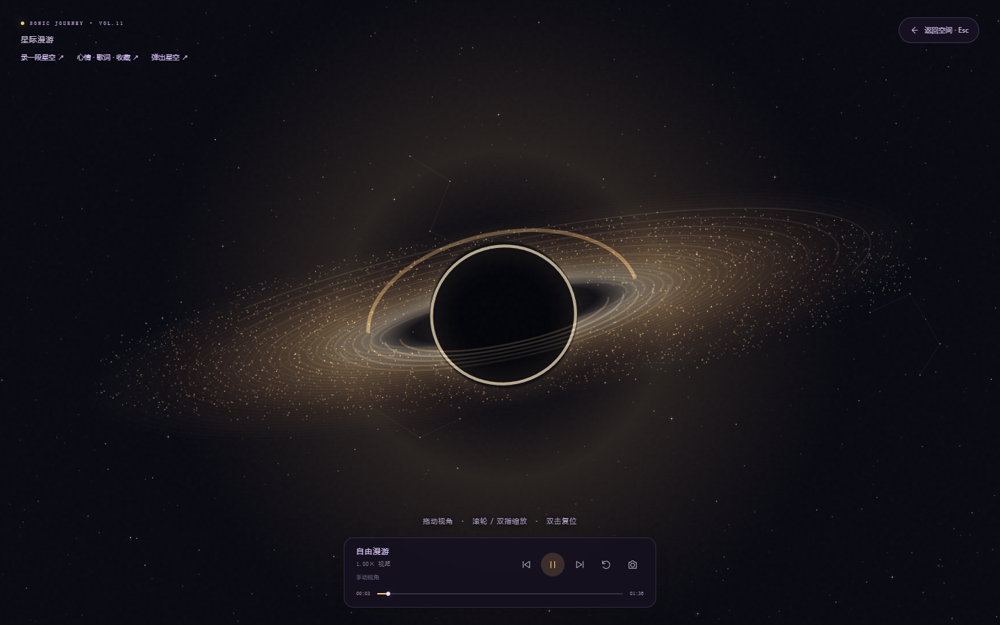

# 声波宇宙 · Sonic Universe

让音乐成为星空。一个在浏览器里运行的音乐视觉作品：低音推开星云，中频留下星轨，高音点亮星闪。在星环、银河、山峰与引力黑洞之间，看见一首歌的起伏。

**[进入在线体验](https://hgb-2005.github.io/sonic-universe/)** · **[完整使用说明](outputs/使用说明.md)** · **[有声黑洞示例](https://hgb-2005.github.io/sonic-universe/blackhole-demo.webm)**

## 第十四版 · 听见星光的层次

这一版继续打磨音乐本身与画面的关系：低音控制星云的扩张与呼吸，200 Hz–4 kHz 的中频频谱留下短暂星轨，高音的变化唤起局部细碎星闪。三层有各自的起落速度；轻声、停顿和暂停后自然收静。星轨记录近期频谱，不进行音符或音高识别。

主页面围绕播放、沉浸、定格和导出展开。原有星际航行收在页脚「星际航行小实验」中，作为可选入口。

新增图层共享主画布、乐器预览与短片输出，也支持 Canvas 兼容模式和系统减少动态效果。短片优先使用 VP8 编码，改善连续切换横竖画幅的录制启动。



## 从一首歌开始

1. 打开在线体验，点击播放，先听内置原创音景；也可以上传自己的 MP3、WAV 等浏览器支持的音频。
2. 打开「视觉预设」，试试「紫雾星环」或「日冕引力」，听低音、旋律与高音分别怎样改变星空；数字键 1 / 2 / 3 / 4 可切换四种形态。
3. 点击「进入宇宙」沉浸漫游。拖动旋转、滚轮缩放，Esc 返回。
4. 保存自己的视觉预设、定格星空明信片，或录制带声音的横屏／竖屏短片。

## 可以在这里创作什么

- **音乐星空**：Web Audio 分析声音，原生 WebGL 绘制星尘；支持连续转场、响应校准、空间纵深与光晕，GPU 不可用时回退到 Canvas。
- **自己的音乐空间**：音乐库、歌单、封面和背景；歌词编辑、歌曲草稿、收藏、A/B 排练与时间点编排。
- **视觉收藏**：四种内置预设，自定义预设保存、JSON 导入／导出，以及创作撤销与重做。
- **星际乐器台**：鼠标、触屏或键盘弹奏旋律与鼓点，录制循环并叠加最多六层。
- **带声音的作品输出**：星空明信片、横屏和竖屏视频；WebGL 图层、歌词与乐器画面共用输出链路。
- **外部声音联动**：在支持的桌面浏览器中，经用户选择和授权，分析带音频的共享来源。



## 本地运行

作品没有构建步骤、运行时依赖或后端服务。克隆或下载仓库后，Windows 用户安装 Python 3，双击 **打开声波宇宙.cmd**。启动器会独立运行本机预览服务，地址是 `http://127.0.0.1:8765/`。重启电脑后再次双击即可。

其他系统也可在仓库根目录运行：

```sh
python -m http.server 8765 --bind 127.0.0.1 --directory outputs
```

随后打开 `http://127.0.0.1:8765/`。建议通过 HTTP 或 HTTPS 使用作品，以便浏览器完整提供音频和存储能力。

## 浏览器与数据

推荐使用桌面版 Edge 或 Chrome。手机支持触屏界面；共享声音、录制编码、全屏及可解码格式取决于浏览器和设备。共享声音需要在浏览器弹窗中选择带音轨的来源并启用音频共享，不能保证所有系统播放器都可捕获。视频采用实时录制，建议让页面保持在前台。

导入的音乐、图片、歌词和草稿保存在当前浏览器中，应用不会把这些文件上传到 GitHub 或其他服务器。**在线版与 `127.0.0.1` 本机版属于不同网站，音乐库和草稿不会自动互通**；不同浏览器也各自保存。视觉预设可以导出 JSON 备份或转移。请保留原始音乐与图片，清除网站数据可能移除本地资料。首次加载在线版需要网络，网页加载完成后音频分析与画面绘制在设备上完成。

## 源码与部署

`outputs/index.html` 包含界面、Web Audio、Canvas 和 WebGL 实现；`outputs/music-motion.js` 处理三层声音包络与近期频谱。`outputs/` 中还包含使用说明和精选原创示例。`serve-universe.py` 与启动器用于本机预览。

航行模式由 `flight.html`、`flight.css`、`flight.js` 和 `flight-core.js` 组成，不加载外部依赖。关卡与计分核心独立于帧率，使用 Web Audio 时钟对齐音乐与事件。它与原音乐星空共享网站地址，各自保存音乐资料和航行成绩。

安装 Node.js 后运行 `node tests/music-motion.test.cjs`，检查静音门限、三层分工、起落、窄频覆盖、频谱历史和帧率一致性；`node tests/flight-core.test.cjs` 检查可选航行的计分和关卡。GitHub Pages 部署前会执行这两项检查。

GitHub Actions 将 `outputs/` 发布到 GitHub Pages；推送到 `main` 的作品更新会自动部署。仓库不包含本机音乐库、调试日志、历史截图或测试音轨。

第十四版在本机 Edge 中用真实 70 / 700 / 6000 Hz 音轨检查三层分工，以及静音文件、暂停收静、Canvas、沉浸和减少动态效果。回归检查覆盖预设导入导出、WebGL 像素与上下文恢复、乐器共用绘制、实际有声横竖屏短片和 320–1440 像素视口。手机布局采用桌面浏览器模拟，尚未在实体手机上验证。

第十一版已在本机 Edge 验证 GPU 与 Canvas 回退、四种形态切换、预设导入导出、数据迁移、实际有声短片录制、320–1440 像素布局及减少动态效果。发布检查另外覆盖项目子路径、连接提示和公网 HTTPS 页面。

## 可选：星际航行小实验

[打开星际航行](https://hgb-2005.github.io/sonic-universe/flight.html?v=13)，也可从音乐星空页脚进入。它有 15 秒安全练习和两种 60 秒航行，使用固定原创关卡与音景。电脑按方向键或 A／D，手机支持滑动或点击航道；空格暂停。返回音乐作品时恢复原歌曲与暂停位置。

航行暂不支持自选歌曲生成关卡，详细操作保留在使用说明附录中。第十三版已自动化检查练习、两种难度、暂停恢复、手动音乐对齐、旧纪录及原歌曲恢复。

## 参考与致谢

以下项目提供了视觉或工程思路：

| 项目 | 参考方向 |
| --- | --- |
| [Interactive Particles Music Visualizer](https://github.com/tgcnzn/Interactive-Particles-Music-Visualizer) | GPU 粒子与形态变换 |
| [Universe Music Visualizer](https://github.com/rrrl2617/universe-music-visualizer) | 黑洞吸积盘与宇宙氛围 |
| [phase-viz](https://github.com/7g3n/phase-viz) | 可序列化、版本化的视觉预设 |
| [Butterchurn](https://github.com/jberg/butterchurn) | 平顺、可中断的预设过渡 |
| [Astrofox](https://github.com/astrofox-io/astrofox) | 音频视觉与视频创作流程 |
| [vibez.surf](https://github.com/donth77/vibez.surf) | 音乐航道、左右移动与目标收集的玩法方向 |
| [Moon Rider](https://github.com/supermedium/moonrider) | 星空航路和沉浸音乐旅程的氛围 |

本作品按上述思路独立实现，没有打包这些项目的源码或运行时。仓库中的示例画面和黑洞视频使用内置原创音景生成。

航行模式的代码、固定关卡、音景与 Canvas 飞船／场景均在本仓库独立实现；参考项目没有作为依赖引入。

## 权利说明

本仓库公开展示作品与源码，暂未授予开源许可证。复用或再分发前请联系作者取得许可。用户自行导入的音乐与图片，其权利属于相应权利人。
